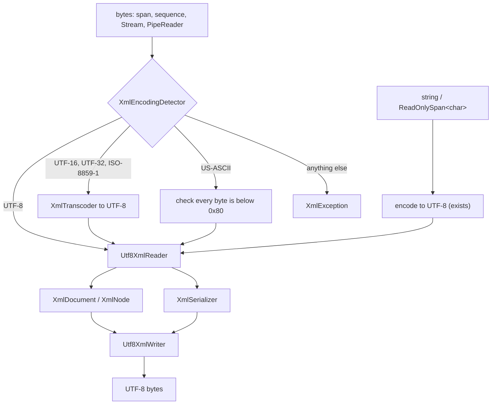

# Expanded encoding support

Part of the [XmlEssentials spec](README.md).

This file is the design for reading XML that is not UTF-8: **UTF-16**, **UTF-32**, **US-ASCII** and **ISO-8859-1**, and for converting such a document to UTF-8. Nothing here is implemented yet, except the parameter rename in [What is already done](#what-is-already-done). The task list is at the end.

## Why

[XML 1.0 §4.3.3](https://www.w3.org/TR/xml/#charencoding) says "All XML processors MUST be able to read entities in both the UTF-8 and UTF-16 encodings." XmlEssentials reads UTF-8 only, which is a departure from the specification that [XML fidelity](02-xml-fidelity.md) records. This design removes it.

UTF-32, US-ASCII and ISO-8859-1 are optional in the specification. They are included because each costs little once UTF-16 is in place:

| Encoding | Why it is cheap |
| --- | --- |
| UTF-32 | Same detection step; four bytes become one code point. |
| US-ASCII | The bytes are already UTF-8. Only the declared name and a range check are new. |
| ISO-8859-1 | Each byte is one code point. No tables. |

ISO-8859-1 is also what legacy documents most often declare. 35 fixture documents in this repository declare it and are rejected today.

## The design in one paragraph

**One UTF-8 engine. Other encodings are converted to UTF-8 before the engine sees them.** `Utf8XmlReader`, `Utf8XmlWriter`, the DOM and the serializer do not change. The entry points that take a document as bytes (`XmlDocument.Parse`, `XmlNode.Parse`, `XmlDocument.DiscoverNamespaces`, `XmlSerializer.Deserialize` and its async forms) detect the encoding and transcode. This is what those entry points already do for a `string`: encode to UTF-8 in a rented buffer, then run the one reader.



### What was considered and not chosen

- **A `Utf16XmlReader`.** Everything after the reader holds UTF-8: the DOM's buffer, the converters (`ref Utf8XmlReader`), `XmlLexical`. A second reader would duplicate the tokenizer, its XML 1.0 and 1.1 rules and its split guarantees, and its output would still be transcoded.
- **Inheriting from the UTF-8 types.** `Utf8XmlReader` is a `ref struct` and cannot be inherited. `Utf8XmlWriter` is sealed, and every write method puts UTF-8 bytes straight into the output buffer, so a subclass would override nearly all of it.
- **Transcoding inside `Utf8XmlReader`.** `ValueSpan` is a slice of the caller's bytes and `BytesConsumed` is the caller's resume offset. Neither survives a transcode.
- **Renaming the types to `UtfXmlReader` / `UtfXmlWriter`.** They still take and produce UTF-8 only, and the names match `Utf8JsonReader` / `Utf8JsonWriter`.

## Scope

| In scope | Out of scope |
| --- | --- |
| Reading UTF-16, UTF-32, US-ASCII and ISO-8859-1 through every high-level entry point that takes bytes | Writing any encoding but UTF-8 (see [UTF-16 output](#utf-16-output-not-in-this-work)) |
| Whole-document and incremental (`DeserializeAsyncEnumerable`) reads | Encodings that need code-page tables: `windows-1252`, `Shift_JIS`, `KOI8-R`, GB18030, EBCDIC |
| A public transcoder, so a caller of `Utf8XmlReader` can convert first | UTF-7, UTF-1, UTF-EBCDIC, SCSU, BOCU-1, CESU-8 |
| Converting a document to UTF-8 | An encoding given by a transport (an HTTP `charset`). See [open decisions](#open-decisions) |

`Utf8XmlReader` stays UTF-8 only. Given other bytes directly it throws as it does today.

## Detection

Detection reads at most the first four bytes, and then the XML declaration if there is one. It follows [Appendix F](https://www.w3.org/TR/xml/#sec-guessing) of XML 1.0, which is not normative but is what every other parser does.

### Step 1: the encoding family, from the first bytes

| First bytes | Family | Byte order mark |
| --- | --- | --- |
| `00 00 FE FF` | UTF-32 big endian | yes, removed |
| `FF FE 00 00` | UTF-32 little endian | yes, removed |
| `00 00 FF FE`, `FE FF 00 00` | UTF-32 in an unusual byte order (2143, 3412) | rejected |
| `FE FF` | UTF-16 big endian | yes, removed |
| `FF FE` (not followed by `00 00`) | UTF-16 little endian | yes, removed |
| `EF BB BF` | UTF-8 | yes, removed by the reader as today |
| `00 00 00 3C` | UTF-32 big endian | no |
| `3C 00 00 00` | UTF-32 little endian | no |
| `00 00 3C 00`, `00 3C 00 00` | UTF-32 in an unusual byte order | rejected |
| `00 3C` (not one of the rows above) | UTF-16 big endian | no |
| `3C 00` (not one of the rows above) | UTF-16 little endian | no |
| anything else | ASCII-compatible: UTF-8, US-ASCII or ISO-8859-1, decided in step 2 | no |

- The UTF-32 rows are tested before the UTF-16 rows, because `FF FE 00 00` begins with the UTF-16 little endian mark.
- `FF FE 00 00` is read as UTF-32. It is also a valid start of UTF-16 text whose first character is U+0000, but U+0000 is not an XML character, so no well-formed document is misread.
- A document shorter than four bytes is judged on the bytes it has. No well-formed document in UTF-16 is shorter than eight bytes (`<a/>`), or sixteen in UTF-32.
- **UTF-16 with no byte order mark is accepted.** §4.3.3 says UTF-16 entities "MUST" begin with one; Appendix F and `System.Xml` detect them anyway from `<` beside a zero byte. This is recorded as a departure in [XML fidelity](02-xml-fidelity.md). Without a mark the document must begin with `<`, so leading white space before the root is not detected and the reader reports the bytes as it does today.

### Step 2: the declared name

The XML declaration is ASCII in every supported family, so it is read as soon as the family is known: one byte per character for the ASCII-compatible family, two for UTF-16, four for UTF-32. `XmlDeclarationSyntax.TryParse` reads the name. Names are compared without regard to ASCII case, as §4.3.3 recommends.

| Family from step 1 | Declared name | Result |
| --- | --- | --- |
| UTF-16 (either order) | none, `utf-16`, `iso-10646-ucs-2`, `ucs-2` | UTF-16 in the detected order |
| UTF-16 little endian | `utf-16le` | UTF-16 little endian |
| UTF-16 big endian | `utf-16be` | UTF-16 big endian |
| UTF-32 (either order) | none, `utf-32`, `iso-10646-ucs-4`, `ucs-4` | UTF-32 in the detected order |
| UTF-32 little endian | `utf-32le` | UTF-32 little endian |
| UTF-32 big endian | `utf-32be` | UTF-32 big endian |
| ASCII-compatible | none, `utf-8`, `utf8` | UTF-8 (today's path, untouched) |
| ASCII-compatible, no UTF-8 byte order mark | `us-ascii`, `ascii` | US-ASCII |
| ASCII-compatible, no UTF-8 byte order mark | `iso-8859-1`, `iso_8859-1`, `latin1` | ISO-8859-1 |
| any | any other pairing | `XmlException` (see [errors](#errors)) |

- **A mismatch is an error**, as §4.3.3 requires: "it is a fatal error for an entity including an encoding declaration to be presented to the XML processor in an encoding other than that named in the declaration". UTF-16 bytes that declare `utf-8`, UTF-8 bytes that declare `utf-16`, and little endian bytes that declare `utf-16be` are all rejected.
- This is why the existing `IgnoreDeclaredEncoding` flag is not reused for bytes. It is replaced by an internal **expected encoding** on `XmlReaderOptions`: `Utf8` (bytes given as UTF-8), `Any` (the document arrived as a `string` or a span of characters, so the name is not checked, as now), or the encoding the transcoder detected (the reader then accepts exactly the names in the table above for it).
- `ucs-2` is read as UTF-16, surrogate pairs included, as `System.Xml` reads it.
- A document labelled `iso-8859-1` is decoded as ISO-8859-1 exactly. Bytes `0x80` to `0x9F` are the C1 controls, not the `windows-1252` punctuation that HTML substitutes.
- US-ASCII and ISO-8859-1 have no signature, so they can only be chosen by a declaration. A document with neither a byte order mark nor a declaration is UTF-8, as §4.3.3 says.

### Detection on a stream

- Detection waits for four bytes, or the end of the input.
- When the document begins with `<?xml` in its family's code units, detection waits for the end of the declaration (`?>`). The search stops at the first `>`, at a byte that cannot be in a declaration (anything outside ASCII), or at the end of the input, and what it buffers is bounded by the limits that bound any unfinished token.
- The declaration is not consumed. The transcoded bytes, declaration included, go to the reader, which checks the declaration's syntax and the expected encoding.

## Transcoding

One internal type, `XmlTranscoder`, with one routine per encoding. Each is strict: bytes that are not legal in the encoding are an `XmlException`, never U+FFFD. §4.3.3: "It is a fatal error if an XML entity is determined ... to be in a certain encoding but contains byte sequences that are not legal in that encoding."

| Encoding | Routine | Invalid input | Largest growth | Carry between blocks |
| --- | --- | --- | --- | --- |
| UTF-16 little endian | The bytes are viewed as `char`s (`MemoryMarshal.Cast`), then `Utf8.FromUtf16(..., replaceInvalidSequences: false, isFinalBlock)` | Half a surrogate pair; an odd number of bytes | 1.5 times (3 bytes from 2) | Up to 3 bytes: one odd byte, or a high surrogate and one odd byte |
| UTF-16 big endian | `BinaryPrimitives.ReverseEndianness` into a rented `char` buffer, then as above | The same | 1.5 times | The same |
| UTF-32 (either order) | Four bytes to a `uint`, `Rune.TryCreate`, `Rune.EncodeToUtf8` | A surrogate code point; a value above U+10FFFF; a length that is not a multiple of four | None (4 bytes from 4) | Up to 3 bytes |
| ISO-8859-1 | Bytes below `0x80` are copied (`Ascii` bulk scan); each other byte becomes two | None: every byte is a code point | 2 times | None |
| US-ASCII | No transcode. `Ascii.IsValid` over the bytes | A byte of `0x80` or above | None | None |

- The byte order mark is removed and none is written. The reader never sees one from a transcoded document.
- On a big endian machine the two UTF-16 routines swap roles. The choice is made from `BitConverter.IsLittleEndian`.
- What is legal *XML* is still the reader's decision, made on the UTF-8: U+0000, the C0 and C1 controls of each XML version, U+FFFE, U+FFFF, and NEL and LS line ends in XML 1.1. The transcoder only decides what is legal in the encoding.
- A US-ASCII document that needs no copy today (a caller's span given to the serializer) still needs none.

## Entry points

All byte-taking entry points gain detection. The work is in the internal funnels, not in the public overloads.

| Entry point | Today | With this design |
| --- | --- | --- |
| `XmlDocument.Parse(ReadOnlySpan<byte>)`, `Parse(ReadOnlySequence<byte>)`, `TryParse`, `XmlNode.Parse(ReadOnlySpan<byte>)` | Copy into a rented buffer, `ParseOwned` | Detect on the source. For UTF-8 and US-ASCII, copy as now. Otherwise rent the transcoded size and transcode into it, in place of the copy. |
| `XmlDocument.Parse(Stream)`, `ParseAsync(Stream)` | `XmlStreamBuffer.ReadToEnd`, `ParseOwned` | Read to the end as now, detect, and transcode into a second rented buffer when needed. The first is returned cleared. |
| `XmlDocument.DiscoverNamespaces` (span and stream) | Reads the bytes in place | Detect; transcode into a rented buffer when needed. |
| `XmlSerializer.Deserialize(ReadOnlySpan<byte>)`, `(ReadOnlySequence<byte>)` | Reads the caller's bytes in place, no copy | UTF-8 and US-ASCII: unchanged, no copy. Otherwise transcode into a rented buffer and read that. |
| `XmlSerializer.Deserialize(Stream)`, `DeserializeAsync(Stream)`, `DeserializeAsync(PipeReader)` | `XmlStreamBuffer.ReadToEnd`, then read | As `XmlDocument.Parse(Stream)`. The `PipeReader` overloads already read through `AsStream`. |
| `XmlSerializer.DeserializeAsyncEnumerable(Stream)` and `(PipeReader)` | Its own loop: read into a buffer, hand the buffer to the reader, keep the unused tail | A source buffer is added in front. Each read is detected (first block only) and transcoded into the existing UTF-8 buffer, with the carry kept in the source buffer. The loop after that point does not change, because its bookkeeping is all in UTF-8 bytes. |
| `XmlSerializer.Deserialize(ref Utf8XmlReader)`, `XmlDocument.ParseValue`, the `Utf8XmlReader` constructors | UTF-8 only | Unchanged. |
| The `string` and `ReadOnlySpan<char>` overloads | Encode to UTF-8; the declared name is not checked | Unchanged. |

The detection at `Utf8XmlReader.Read` that reports UTF-16 and UTF-32 today stays where it is, for callers who construct the reader themselves.

### Limits and positions

- **`MaxDocumentByteCount` counts source bytes**: the size of what the caller gave, which is what the caller can measure. The reader created for the transcoded bytes is not given the limit a second time.
- A transcoded size that passes `Array.MaxLength` is the same `XmlException` as a document over the limit.
- **`XmlException.LineNumber` and `LinePosition` are unaffected**: lines and characters are the same in every encoding.
- **`XmlException.BytePosition` is `null` for a transcoded document.** An offset into the UTF-8 copy would point at nothing the caller holds, and mapping it back to a source offset is exact only for the fixed-width encodings. See [open decisions](#open-decisions).

## Public API

The parameter rename is the only change to existing signatures. One type is added, so that a caller of `Utf8XmlReader` or of any other UTF-8 consumer can convert first, and so that "convert this document to UTF-8" is a single call.

```csharp
namespace CloudNimble.Text.Xml
{
    public static class XmlTranscoder
    {
        // Whole document.
        public static byte[] ToUtf8(ReadOnlySpan<byte> xml);
        public static void ToUtf8(ReadOnlySpan<byte> xml, IBufferWriter<byte> utf8Xml);

        // Streaming: bounded memory, one block at a time.
        public static void ToUtf8(Stream xml, Stream utf8Xml);
        public static Task ToUtf8Async(Stream xml, Stream utf8Xml, CancellationToken cancellationToken = default);
    }
}
```

`XmlTranscoder.ToUtf8` converts bytes, and does not parse:

- Detection and strictness are exactly those above. Unsupported and mislabelled input is an `XmlException`.
- **The declaration's encoding name is rewritten to `utf-8`.** Without that, the output would say `utf-16` and the reader would reject it. Nothing else in the declaration changes: the quotes, the spacing, `version` and `standalone` are kept. A declaration with no encoding name is left alone, and none is added to a document that has no declaration.
- The byte order mark is removed and none is written.
- UTF-8 input is validated (`Utf8.IsValid`) and copied, without its byte order mark. US-ASCII input has its name rewritten and is otherwise copied.
- The rest of the document is not examined. Text that is not well-formed XML is transcoded as it is and fails later, in the reader.

### Two ways to convert a document to UTF-8

| | `XmlTranscoder.ToUtf8` | `XmlDocument.Parse` then `WriteTo` |
| --- | --- | --- |
| Checks well-formedness | No | Yes |
| What changes | The encoding, the declared name, the byte order mark | Everything a named writer setting governs ([round-trip guarantees](02-xml-fidelity.md#round-trip-guarantees)): quotes, white space inside tags, empty-element form, line ends, the declaration's spelling |
| Memory | One block at a time on a stream | The whole document |

## Errors

Messages are part of the contract, so each is exact. The two existing messages keep their text where they still apply.

| Condition | Message |
| --- | --- |
| UTF-16 or UTF-32 bytes given to `Utf8XmlReader` directly | `XmlEssentials is UTF-8 only. The input is UTF-16 or UTF-32.` (unchanged) |
| UTF-8 bytes given to `Utf8XmlReader` directly, with a declaration that names another encoding | `XmlEssentials is UTF-8 only. Declared encoding '{name}' is not supported.` (unchanged) |
| A high-level entry point or `XmlTranscoder`: a declared name that is not in the table | `The encoding '{name}' is not supported. XmlEssentials reads UTF-8, UTF-16, UTF-32, US-ASCII and ISO-8859-1.` |
| The declared name does not match the bytes | `The document is {detected} but its declaration names '{name}'.` |
| UTF-32 in byte order 2143 or 3412 | `UTF-32 in an unusual byte order is not supported.` |
| Half a surrogate pair in UTF-16 | `Invalid UTF-16.` |
| UTF-16 input that ends in the middle of a code unit | `Invalid UTF-16.` |
| A surrogate, a value above U+10FFFF, or a truncated code unit in UTF-32 | `Invalid UTF-32.` |
| A byte of `0x80` or above in US-ASCII | `Invalid US-ASCII.` |

`{detected}` is `UTF-8`, `UTF-16 little endian`, `UTF-16 big endian`, `UTF-32 little endian` or `UTF-32 big endian`. `{name}` is the declared name in lower case, as today. `Invalid UTF-16.` and its siblings mirror the existing `Invalid UTF-8.`

## UTF-16 output (not in this work)

The specification obliges a processor to read UTF-16, not to write it, and every conforming parser reads UTF-8. If a consumer ever needs UTF-16 files, the mirror design applies and nothing above blocks it:

- an output adapter that turns the writer's UTF-8 into UTF-16 (`Utf8.ToUtf16`) and writes the byte order mark;
- the declaration's encoding name, hard-coded as `utf-8` in `Utf8XmlWriter` and `XmlDocument`, made a parameter;
- the choice offered on `XmlSerializer.Serialize` and `XmlDocument.WriteTo`, or as a public adapter stream, and not on `XmlWriterOptions`, so that `Utf8XmlWriter` keeps writing only UTF-8.

## Tests

Every rule above gets a test that states the behaviour and asserts the exact result ([testing](14-testing.md)).

- **`XmlEncodingInputTests`**: the UTF-16 and UTF-32 rows that assert a rejection through the high-level entry points become reads with exact results. The rows that go through `Utf8XmlReader` directly keep asserting the unchanged message. New rows: each declared name in the table, each mismatch, each `Invalid ...` message, the unusual UTF-32 orders, and `us-ascii` with a byte above `0x7F`.
- **Every fixture, re-encoded.** A property test encodes each well-formed fixture document as UTF-16 and UTF-32, little and big endian, with and without a byte order mark, and requires the token list of the UTF-8 original. Documents that are pure ASCII or Latin-1 are also re-encoded as US-ASCII and ISO-8859-1, with the declaration rewritten. The expected bytes are computed in the test with the BCL encoders, which is an independent implementation.
- **Splits at every byte offset**, in the style of `Utf8XmlReaderSplitTests`: the incremental path and `XmlTranscoder.ToUtf8(Stream, Stream)` are fed every split of a document that has a surrogate pair and a three-byte character, so that a block ends inside a code unit and between the halves of a pair. The result must equal the single-pass result.
- **Both XML versions.** NEL (`0x85` in ISO-8859-1) and the C1 controls reach the reader as two-byte UTF-8 sequences. They are tested in text and in attribute values under XML 1.0 and 1.1, because the two versions treat them differently.
- **`XmlTranscoder`**: exact output bytes for each encoding; the declaration rewritten with single and double quotes, with and without `standalone`, and left alone when it has no encoding name.
- **Conformance suite.** `XmlConformanceSuiteTests.Classify` changes: a document that declares `iso-8859-1` and has no DTD moves into the subset and must match its manifest type, and `Invalid UTF-8.` is no longer the answer for its high bytes. `ExpectedInSubset` rises by the number of such documents (three of the 35 Latin-1 fixtures have no `<!DOCTYPE`; confirm when implementing). The suite's own UTF-16 documents carry DTDs and stay outside the subset, so none is added for this.
- **Allocation.** UTF-8 input must allocate what it allocates today. The existing `*AllocationTests` hold that.
- **Coverage.** The gate stays at 100% line and 100% branch. Each transcoder branch is reached by a real document; internal preconditions go in `*InternalsTests`.

No benchmark is run until the end of the work, by the owner's standing instruction. The only measurement owed then is that the UTF-8 paths have not moved.

## Spec and documentation changes that go with the implementation

- [XML fidelity](02-xml-fidelity.md): the "UTF-8 only" bullet, the "Non-UTF-8 encoding in declaration" row, the limits table (what `MaxDocumentByteCount` counts), and a new departure for UTF-16 without a byte order mark.
- [Doc findings resolution](24-doc-findings-resolution.md) decisions 8 and 9 are superseded for the high-level entry points; note it there.
- [Reader](04-api-reader.md): say that the reader is UTF-8 only and point to `XmlTranscoder`.
- [DOM](06-api-dom.md) and [serializer](07-api-serializer.md): the byte-taking entry points accept the encodings above. A new API page for `XmlTranscoder`.
- [Key decisions](01-identity-and-decisions.md): one row for "one UTF-8 engine; other encodings are transcoded at the entry points".
- [Security](18-security.md): the transcode can double the size of the input in memory (ISO-8859-1), bounded by `MaxDocumentByteCount` on the source.
- Guides: the migration pages that say input must be UTF-8, `xml-conformance.mdx`, and the `Utf16Declaration` sample in `40_MigrateFromXmlSerializer.cs`. A short guide on reading other encodings and converting to UTF-8. XML doc comments on the renamed parameters stop saying "UTF-8 encoded".

## What is already done

**The parameter rename (2026-11-25).** Nothing has shipped, so the names were changed outright. Every public entry point that takes a document as bytes and will detect its encoding now names the parameter `xml`, as the `string` overloads do:

- `XmlDocument.Parse` (span, sequence, stream), `ParseAsync`, `TryParse`, `DiscoverNamespaces` (span, stream)
- `XmlNode.Parse(ReadOnlySpan<byte>)`
- `XmlSerializer.Deserialize` (span, sequence, stream), `DeserializeAsync` (stream, pipe), `DeserializeAsyncEnumerable` (stream, pipe)

Parameters that really are UTF-8 keep `utf8Xml`: the `Utf8XmlReader` constructors, `Utf8XmlWriter`, and every `Serialize` overload.

## Open decisions

1. **The name and shape of the public transcoder.** `XmlTranscoder.ToUtf8` is proposed above. An alternative is a read-only `Stream` wrapper that yields UTF-8, which composes with any consumer but is a larger surface.
2. **`BytePosition` for a transcoded document.** `null` is proposed. The alternative is the offset in the UTF-8 copy, which is exact but not an offset the caller can use.
3. **An encoding supplied by the caller.** §4.3.3 lets a transport (an HTTP `charset`) decide the encoding. Nothing above takes one. If it is wanted, it is an `Encoding`-like option on `XmlDocumentOptions` and `XmlSerializerOptions` that replaces step 2 of detection.
4. **More declared names.** The table accepts the IANA names and the common short forms. Aliases such as `l1`, `ibm819`, `cp819`, `iso646-us` or `csASCII` are not accepted. Add them only if a real document needs one.

## Task list

1. `XmlEncodingDetector` (internal): the two detection steps, with tests for every row of both tables.
2. `XmlTranscoder` internals: the five routines, block-at-a-time with a carry, with exact-output and invalid-input tests.
3. Replace `IgnoreDeclaredEncoding` with the expected encoding on `XmlReaderOptions`; the reader's declaration check accepts the names of the expected encoding.
4. Whole-document entry points: `XmlDocument` (`ParseOwned` callers, `DiscoverNamespaces`), `XmlNode.Parse`, `XmlSerializer.Read` (span, sequence, stream, async).
5. Incremental entry point: the `DeserializeAsyncEnumerable` loop.
6. Public `XmlTranscoder.ToUtf8`, with the declaration rewrite.
7. Tests: the re-encoded fixture property test, the split tests, both XML versions, `XmlEncodingInputTests`, the conformance classification and counts.
8. The spec and documentation changes listed above; coverage gate; then the benchmark check that UTF-8 paths have not moved.

---

[Index](README.md) · [Previous: Single engine metadata](25-single-engine-metadata.md) · [Next: XPath 1.0](27-xpath.md)
