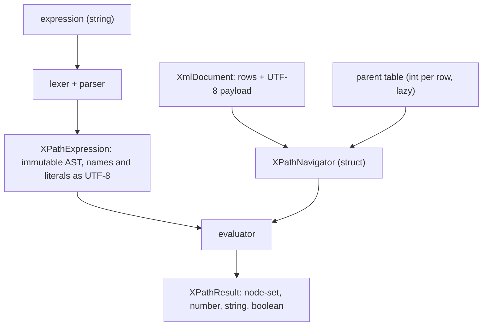

# XPath 1.0

Part of the [XmlEssentials spec](README.md).

This file is the design for evaluating **XPath 1.0** expressions over the read-only `XmlDocument`. Its centre is the **navigator**: the layer that presents the document's row store as the XPath data model. Nothing here is implemented yet. The task list is at the end.

The engine is a port of the XPath 1.0 engine in [Xemele](https://github.com/sebastienros/xemele) (`src/Xemele/XPath`, MIT). The grammar, the conversions and the 27 core functions come from there. The navigator does not: Xemele's copies the whole document into strings before it evaluates anything, and that is the part this design replaces.

## Why

`XmlElement.GetChild` and `EnumerateChildren` reach a value one level at a time. A query that crosses levels, filters on an attribute or counts nodes is a loop the caller writes by hand. XPath 1.0 is the query language every XML user already knows, and `System.Xml` is the only place a .NET caller gets it today.

Normative reference: [XML Path Language (XPath) Version 1.0, W3C Recommendation 16 November 1999](https://www.w3.org/TR/1999/REC-xpath-19991116/). Where this file and the Recommendation disagree, this file is wrong.

## The design in one paragraph

**A node is a 64-bit id that is derived from its row index, and ids sort in document order.** The navigator is a `readonly struct` over an `XmlDocument`. It answers three questions about an id: which ids an axis reaches from it, what its name is, and what its string-value is. Every answer is read from the row store as UTF-8. No node object, no name string and no value string is made while an expression is evaluated, except for a value that has to be put together from several rows. The one thing the navigator adds to a document is a **parent table**, one `int` for each row, built the first time an axis needs it.



### What was considered and not chosen

- **Xemele's snapshot navigator.** It walks the document once for each evaluation and stores, for every node, its string-value, local name, namespace URI and prefix as `string`. The string-value of an element is all the text under it, so the text of the document is copied once for every level of nesting. The row store already is a document-order snapshot with an end index for each element. Copying it gains nothing.
- **A parent index in `XmlDbRow`.** The row is 32 bytes and every field is used ([DOM storage](06-api-dom.md#storage)). A parent link would grow every document for callers who never run a query.
- **Finding a parent by scanning backwards.** The parent of row `r` is the nearest earlier element row whose end index is beyond `r`. The scan passes over every row of every preceding sibling, so one lookup is linear in the size of the document.
- **`XmlElement` as the node type.** It has no value for the document node or for a namespace node, and `/` and `..` from the document element both select the document node.
- **`int` ids.** A namespace node sits between its element and that element's first attribute in document order, and the two rows are adjacent. There is no `int` between them.
- **An interface or base class for the navigator.** There is one document model to navigate in this work. A second navigator, for the mutable `XmlNode` tree, can be written against the same contract when it is wanted ([out of scope](#scope)); the interface is extracted then, with two implementations to shape it.
- **UTF-16 strings inside the engine.** Every name and value in the document is UTF-8. Comparing `@id = 'x'` as bytes needs no transcoding; comparing it as `string` allocates one string for each node tested.

## Scope

| In scope | Out of scope |
| --- | --- |
| XPath 1.0 in full: all 13 axes, every node test, predicates, the 14 binary operators, unary minus, variables, the 27 core functions | XPath 2.0 and later; XSLT functions (`document`, `key`, `current`, `format-number`, …) |
| The read-only `XmlDocument` | The mutable `XmlNode` tree |
| Compile once, evaluate many times, from several threads at once | Extension functions supplied by the caller |
| Results as nodes (`XPathNode`), and as number, string and boolean | `id()` finding anything: there is no DTD, so no attribute has type ID, and `id()` returns the empty node-set |
| | Convenience members on `XmlElement` and `XmlDocument` (`SelectNodes(string)`). See [open decisions](#open-decisions) |

## The XPath data model over the row store

Rows are in document order: an element row, its attribute rows, then its descendants ([DOM storage](06-api-dom.md#storage)). The reader skips white space outside the document element, so a row with no element above it is a comment, a processing instruction or the document element.

| XPath node | In the row store |
| --- | --- |
| Root (the document node) | No row. It is the parent of every row that has no element above it. |
| Element | A row of kind `Element`, `EmptyElement` or `Nil`. |
| Attribute | A row of kind `Attribute` that is **not** a namespace declaration (`XmlDocument.IsNamespaceDeclaration`). |
| Namespace | No row. One for each prefix in scope on an element, and always one for `xml`. |
| Text | A maximal run of adjacent sibling rows of kind `Text` or `CData` whose values together are not empty. The node is the first row of the run. |
| Comment | A row of kind `Comment`. |
| Processing instruction | A row of kind `ProcessingInstruction`. |

Three things in the row store are **not** nodes: a namespace declaration row (`xmlns`, `xmlns:p`), a row of a text run after the first, and a text run with no characters (`<![CDATA[]]>` alone). The XML declaration has no row and is not a node.

The data model is that of the document **as it was parsed**. With `XmlCommentHandling.Skip` there are no comment nodes, and the text on either side of a skipped comment is one text node. With `XmlWhitespaceHandling.Insignificant` there are no white-space text nodes between elements.

### Node ids

```text
bits 63..32   row index + 1, or 0 for the document node
bits 31..0    sub: 0 for the node the row is; 1 for the xml namespace node of the element;
              d + 2 for the namespace node of the element that the declaration at row d binds
```

| Node | Id |
| --- | --- |
| Document node | `0` |
| The node at row `r` | `(long)(r + 1) << 32` |
| Namespace node `xml` of the element at row `e` | `((long)(e + 1) << 32) \| 1` |
| Namespace node of the element at row `e`, bound by the declaration at row `d` (on `e` or on an ancestor) | `((long)(e + 1) << 32) \| (uint)(d + 2)` |

**Ids compare as document order.** An element is before its namespace nodes, which are before its attributes (the next rows), which are before its children. So a node-set is a sorted array of `long` with no duplicates, union is a merge, and "is this node already in the set" is a comparison of two numbers.

The Recommendation leaves the order of the namespace nodes of one element, and of its attributes, to the implementation. Here namespace nodes are ordered by the row of their declaration, `xml` first, and attributes are in the order of the start tag.

A namespace node names its declaration row, so its prefix and its URI are read from that row directly. Two elements that share an inherited binding have two different namespace nodes (different high halves), as the Recommendation requires.

### The parent table

`int[] parents`, one entry for each row: the row index of the parent element, or `-1` for a row whose parent is the document node. An attribute row holds its element.

It is built in one pass with no stack, because the row before `r` is either the parent of `r` or a node below a preceding sibling of `r`:

```csharp
parents[0] = -1;
for (var r = 1; r < rowCount; r++)
{
    var p = r - 1;
    while (p >= 0 && !(IsElement(p) && End(p) > r))
    {
        p = parents[p];
    }

    parents[r] = p;
}
```

Each step of the inner loop leaves an element that has ended and is never entered again, so the pass is linear in the number of rows.

- The table belongs to the `XmlDocument` (`internal int[] GetParentTable()`), is built on first use, and is published with `Interlocked.CompareExchange`, so two threads that race both get a correct table and one of them is kept. `Dispose` lets it go.
- It is a plain array, not a pooled one: a document that is never queried rents nothing more, and `Dispose` gains no new path. [Open decision 4](#open-decisions).
- **It is not built unless it is needed.** These never ask for it, and a test holds that ([testing](#testing)): `self`, `child` and `attribute`; `descendant`, `descendant-or-self`, `following` and `preceding` with a node test that cannot match a text node; and anything asked of an attribute or namespace node about its element, which is found by stepping back over the attribute rows. A path such as `/feed/entry[@id = $id]/title` reads a document of any size without it.

It is needed for: `parent` and the ancestor axes from an element or a leaf; `following-sibling` and `preceding-sibling`; the `namespace` axis and `lang()`, which walk up; and telling whether two adjacent text rows are siblings (below).

### Text runs

A leaf row followed by another row is not always its sibling: in `<a><b>x</b>y</a>` the rows of `x` and `y` are adjacent and both are text, but `x` is a child of `b` and `y` a child of `a`. Rows `i` and `i + 1` are in one run when both are `Text` or `CData` **and** `parents[i] == parents[i + 1]`.

- Row `i` starts a run when it is `Text` or `CData` and row `i - 1` is not, or has a different parent. The kind of row `i - 1` is checked first, so the table is read only when two text rows are adjacent.
- Row `i` is a text node when it starts a run and some row of the run has a value that is not empty.
- The `child` axis walks siblings one after another, so it knows which rows are adjacent siblings from its own walk and does not read the table.
- A context node given as an `XmlElement` on a later row of a run is moved to the first row of the run. A run with no characters, and a namespace declaration, are rejected with `ArgumentException`: neither is a node.

## The navigator

```csharp
namespace CloudNimble.Text.Xml.XPath
{
    internal readonly struct XPathNavigator
    {
        internal XPathNavigator(XmlDocument document);

        // Appends to output, in document order, every node on axis from context that passes test.
        // Returns the number of rows it looked at, which the evaluator charges to MaxOperations.
        internal long Select(long context, XPathAxis axis, XPathNodeTest test, ref XPathIdBuffer output);

        internal XPathNodeKind KindOf(long id);
        internal long ParentOf(long id);                       // -1 for the document node

        internal ReadOnlySpan<byte> LocalName(long id);        // element, attribute: local name; PI: target; namespace: prefix; else empty
        internal ReadOnlySpan<byte> NamespaceUri(long id);     // element, attribute; else empty
        internal ReadOnlySpan<byte> Prefix(long id);           // element, attribute; else empty

        internal ReadOnlyMemory<byte> StringValue(long id);    // see String-values
        internal ReadOnlySpan<byte> Language(long id);         // the xml:lang in scope, for lang()
        internal long FromElement(XmlElement element);         // a public cursor to an id; throws ArgumentException for a non-node
    }
}
```

`Select` is the one member that does work in proportion to the document, and it is one call for each context node of a step, not one for each node it looks at. The node test is applied inside it, on the row, so a row that does not match costs a kind check and at most two `SequenceEqual` calls.

**`Select` always appends in ascending id order**, for the reverse axes as well. The evaluator needs proximity position only inside a predicate, and it gets it from the index: `index + 1` on a forward axis, `count - index` on `ancestor`, `ancestor-or-self`, `preceding` and `preceding-sibling`.

### Axes

For a row `r`: `IsElement(r)`; `End(r)` is the element's end index; `FirstChild(r) = r + 1 + AttributeCount(r)`; `Next(r) = IsElement(r) ? End(r) : r + 1` (`XmlDocument.NextSiblingIndex`); `P(r)` is the parent table; `n` is the row count. "Content rows" means rows that are not of kind `Attribute`, with a text row counted only when it is a text node.

From **an element or a leaf at row `r`**:

| Axis | Rows |
| --- | --- |
| `self` | `r` |
| `child` | Element only: `c = FirstChild(r)`; while `c < End(r)`; `c = Next(c)` |
| `descendant` | Element only: content rows in `[FirstChild(r), End(r))` |
| `descendant-or-self` | `r`, then `descendant` |
| `parent` | `P(r)`, or the document node when it is `-1` |
| `ancestor` | `P(r)`, `P(P(r))`, … and then the document node |
| `ancestor-or-self` | `ancestor`, then `r` |
| `following-sibling` | `s = Next(r)`; while `s < End(P(r))`, or `s < n` when `P(r)` is `-1`; `s = Next(s)` |
| `preceding-sibling` | `s = FirstChild(P(r))`, or `0` when `P(r)` is `-1`; while `s < r`; `s = Next(s)` |
| `following` | Content rows in `[Next(r), n)` |
| `preceding` | Content rows `i` in `[0, r)` that are not an ancestor of `r`: not (`IsElement(i)` and `End(i) > r`) |
| `attribute` | Element only: rows `r + 1 … r + AttributeCount(r)` that are not namespace declarations |
| `namespace` | Element only: see below |

From **the document node**: `self` and `ancestor-or-self` are the node itself; `child` is `s = 0`; while `s < n`; `s = Next(s)`; `descendant` is every content row; `descendant-or-self` adds the node itself. Every other axis is empty.

From **an attribute or a namespace node** whose element is at row `e`: `self`; `parent` is `e`; `ancestor` is `e` and its ancestors; `ancestor-or-self` adds the node itself; `descendant-or-self` is the node itself; `following` is the content rows in `[FirstChild(e), n)`; `preceding` is `preceding` of `e`. `child`, `descendant`, `attribute`, `namespace` and both sibling axes are empty.

**The `namespace` axis** of the element at row `e`: the `xml` node first. Then, from `e` up through its ancestors, each namespace declaration row `d` whose prefix has not been met on a nearer element gives a node, unless the declaration has an empty value (`xmlns=""`, or `xmlns:p=""` in XML 1.1), which hides the prefix and gives nothing. A declaration of the prefix `xml` gives nothing: the `xml` node is already there. The nodes are appended in ascending order of `d`.

### Node tests

The parser resolves every prefix against `XPathOptions.Namespaces` and stores the local name and the namespace URI of a name test as UTF-8. An unprefixed name is in no namespace; the default namespace of the document does not apply (Recommendation §2.3).

| Test | A row passes when |
| --- | --- |
| `name`, `p:name` | It is of the principal node type of the axis, and its local name and namespace URI equal the test's, byte for byte |
| `*` | It is of the principal node type |
| `p:*` | It is of the principal node type and its namespace URI equals the test's |
| `node()` | It is a node |
| `text()` | It is a text node |
| `comment()` | It is of kind `Comment` |
| `processing-instruction()`, `processing-instruction('t')` | It is of kind `ProcessingInstruction`, and with a literal, its target equals it |

The principal node type is attribute on the `attribute` axis, namespace on the `namespace` axis, and element on every other axis. On the `namespace` axis a name test compares the prefix, and passes only with no namespace URI.

### String-values

| Node | String-value |
| --- | --- |
| Document node, element | The values of every `Text` and `CData` row under it, in order |
| Attribute | The value of the row |
| Namespace | The URI: the value of the declaration row, or `http://www.w3.org/XML/1998/namespace` for `xml` |
| Text | The values of the rows of the run |
| Comment | The value of the row |
| Processing instruction | The value of the row, which is the data without the target |

`StringValue` returns `ReadOnlyMemory<byte>` over the document's own buffers when the value is one row, which it is for an attribute, a comment, a processing instruction, a text run of one row, and an element with one text child. Otherwise it returns a new array of exactly the length needed. `XmlDocument` gains an internal `SliceMemory(int start, int length)` beside `Slice`.

**No value that points into the document leaves the engine.** The document's buffers are rented, and `Dispose` returns them. A string result is made a `string` before `Evaluate` returns, and a node in a result holds the document and an id, which is checked for disposal when it is used, as `XmlElement` is.

## Evaluation

The evaluator is a plain recursive walk of the AST. Xemele runs its evaluator on a chain of heap frames so that an expression of any depth cannot overflow the stack, and charges every comparison to a budget. Here the parser refuses an expression nested deeper than `MaxDepth`, which bounds the recursion, and one counter is the budget. Neither Xemele's frame chain nor its accounting is ported.

- **Values.** A value is a node-set (ascending `long[]` and a count), a `double`, a `bool`, or a string held as UTF-8 (`ReadOnlyMemory<byte>`).
- **A step** takes each context node in order, calls `Select`, and runs the predicates over what it appended, one predicate after another, each with the size the last one left. The results for all context nodes go into one list. If that list is not ascending it is sorted; then duplicates are dropped. A step with no predicate lets `Select` append to the result directly.
- **A predicate** whose value is a number passes when the number equals the proximity position; any other value is converted with `boolean()`.
- **Comparisons** follow Recommendation §3.4. A node-set compared with a string compares the UTF-8 of each string-value with the UTF-8 of the string. Compared with a number, each string-value is parsed as a number from its bytes.
- **Numbers.** `number()` of a string accepts optional white space, an optional `-`, and `Digits ('.' Digits?)? | '.' Digits`; anything else is `NaN`. No `+`, no exponent, no `Infinity`. `string()` of a number writes no exponent, `NaN`, `Infinity`, `-Infinity`, and `0` for both zeros. Port `XPathConversions.ParseNumber` and `FormatNumber` from Xemele, on bytes.
- **Characters are Unicode code points.** `string-length`, `substring` and `translate` count code points, as the Recommendation says (§4.2, "characters"), which in UTF-8 is counting the bytes that are not continuation bytes. `System.Xml` counts UTF-16 code units, so `string-length('😀')` is 1 here and 2 there. `contains`, `starts-with`, `substring-before` and `substring-after` search bytes, which is exact for well-formed UTF-8.
- **`lang()`** reads `Language` and compares without regard to ASCII case, accepting a value that is the argument or the argument followed by `-`.
- **`id()`** converts its argument as the Recommendation says and returns the empty node-set.
- **Limits.** `MaxDepth` bounds the nesting of an expression (default 64, the default depth limit of the reader). `MaxOperations` bounds the rows `Select` looks at plus the nodes the functions read, across one `Evaluate`; `0`, the default, is no limit. Exceeding either throws `XPathException`. An expression is code: the size of the document is already bounded by `MaxDocumentByteCount`, and a fixed expression costs a fixed power of it. A caller who evaluates an expression it did not write sets `MaxOperations` ([security](18-security.md) gains a row).

## Public API

```csharp
namespace CloudNimble.Text.Xml.XPath
{
    public sealed class XPathExpression
    {
        public static XPathExpression Compile(string expression, XPathOptions? options = null);

        public string Expression { get; }

        public XPathResult Evaluate(XmlDocument document, XPathVariables? variables = null);   // the context node is the document node
        public XPathResult Evaluate(XmlElement context, XPathVariables? variables = null);
        public XPathResult Evaluate(XPathNode context, XPathVariables? variables = null);

        // Evaluate, then GetNodeSet. Throws XPathException when the expression does not yield a node-set.
        public XPathNodeSet Select(XmlDocument document, XPathVariables? variables = null);
        public XPathNodeSet Select(XmlElement context, XPathVariables? variables = null);
        public XPathNodeSet Select(XPathNode context, XPathVariables? variables = null);
    }

    public sealed class XPathOptions
    {
        public IReadOnlyDictionary<string, string>? Namespaces { get; set; }   // prefix to URI, for names in the expression; takes the result of XmlDocument.DiscoverNamespaces
        public int MaxDepth { get; set; }                                       // 0 is the default, 64
        public long MaxOperations { get; set; }                                 // 0 is no limit
    }

    public sealed class XPathVariables
    {
        public void Set(string localName, string value, string namespaceUri = "");
        public void Set(string localName, double value, string namespaceUri = "");
        public void Set(string localName, bool value, string namespaceUri = "");
        public void Set(string localName, XPathNodeSet value, string namespaceUri = "");
    }

    public enum XPathResultKind : byte { NodeSet = 0, Boolean = 1, Number = 2, String = 3 }

    public readonly struct XPathResult
    {
        public XPathResultKind Kind { get; }
        public bool GetBoolean();          // boolean() of the result, whatever its kind
        public double GetNumber();         // number() of the result
        public string GetString();         // string() of the result
        public XPathNodeSet GetNodeSet();  // InvalidOperationException unless Kind is NodeSet
    }

    public sealed class XPathNodeSet : IReadOnlyList<XPathNode>
    {
        public int Count { get; }
        public XPathNode this[int index] { get; }   // document order
        public Enumerator GetEnumerator();          // a struct, so foreach does not allocate
    }

    public enum XPathNodeKind : byte { Document = 0, Element = 1, Attribute = 2, Namespace = 3, Text = 4, Comment = 5, ProcessingInstruction = 6 }

    public readonly struct XPathNode : IEquatable<XPathNode>
    {
        public XPathNodeKind Kind { get; }
        public string LocalName { get; }
        public string NamespaceUri { get; }
        public string Prefix { get; }
        public string GetString();                        // the string-value
        public XmlElement GetElement();                   // InvalidOperationException for Document and Namespace
        public bool TryGetElement(out XmlElement value);  // the cursor on the row; for a text node, on the first row of the run
    }

    public sealed class XPathException : Exception
    {
        public int? Position { get; }   // the zero-based character offset in the expression, when the error has one
    }
}
```

- `Compile` copies what it needs from the options; changing them afterwards changes nothing. An `XPathExpression` is immutable and may be evaluated from several threads at once, over one document or many.
- A prefix in the expression that `Namespaces` does not bind, an unknown function, a wrong number of arguments and a syntax error are `XPathException` from `Compile`, each with a `Position`. A variable with no value, a value of the wrong type where a node-set is required, and a limit are `XPathException` from `Evaluate`. The messages are part of the contract, as the reader's are ([testing](14-testing.md)).
- A default `XmlElement` or `XPathNode`, a namespace declaration, and a node-set variable from another document are `ArgumentException`. A disposed document is `ObjectDisposedException`.
- `XPathNode` and `XPathNodeSet` are cursors into the document, like `XmlElement`: they are used before the document is disposed. A default `XPathNode` throws `InvalidOperationException` from every member, as a default `XmlElement` does.
- The names collide with `System.Xml.XPath`, as `XmlDocument` and `XmlElement` collide with `System.Xml`. That is accepted for the same reason ([DOM](06-api-dom.md)).

## What comes from Xemele

| Xemele (`src/Xemele/XPath`) | Here |
| --- | --- |
| `Compilation/Lexer.cs`, `XPathCompiler.cs`, `Number.cs`, `Resolution.cs` | Ported: the grammar, the rules that tell `*`, `and`, `or`, `div` and `mod` as operators from the same text as names, and the expansion of `.`, `..`, `@` and `//`. Names and literals are stored as UTF-8. Cancellation and the token and character limits are dropped; `MaxDepth` stays. |
| `Model/Ast.cs` | Ported without the guards that re-validate what the parser has just built. |
| `Functions/CoreFunctions.cs`, `Model/CoreSignatures.cs` | Ported: the 27 functions and their arities, rewritten to work on UTF-8 and to count code points. |
| `Model/Values.cs` (`XPathConversions`) | Ported: number parsing and formatting. |
| `Evaluation/Evaluator.cs`, `NodeSets.cs` | Rewritten as described under [evaluation](#evaluation). |
| `Navigation/XPathNavigator.cs`, `Model/Items.cs`, `Model/Budget.cs`, `Model/ContextMap.cs`, `Model/ContextScan.cs`, `Evaluation/Accounting.cs` | Not ported. This file replaces them. |
| `tests/corpora/xpath/inventory.json`, `tests/Xemele.Tests/M4-*`, `docs/specs/xpath.md` | The source of test cases: one acceptance vector for each axis, operator, function and grammar edge. Rewritten in this repository's test style. |

The code follows this repository's rules, not Xemele's: one type to a file, block namespaces, regions, XML documentation on every public member, no `System.Xml` ([AGENTS.md](../AGENTS.md)).

## Testing

- **The navigator, exactly.** One fixture document holds every kind of node, namespace declarations that are inherited, hidden and undeclared, adjacent text and CDATA, an empty CDATA section, text next to the end of a nested element, and comments and processing instructions before and after the document element. For each of the 13 axes from each kind of context node, the test asserts the complete list of nodes selected, in order. `XPathNavigatorInternalsTests` asserts the parent table of that document entry by entry.
- **The Recommendation's own examples.** Every location path in §2 and §2.5, the `substring` and `round` cases in §4.2 and §4.4, and the comparison rules in §3.4, each with its exact result.
- **The compiler.** Every production of the grammar, and for every rejection the exact message and `Position`.
- **Both document options.** The same expressions over a document parsed with comments skipped and with insignificant white space left out, with the node counts that follow.
- **Laziness.** A test evaluates paths that use only the axes listed under [the parent table](#the-parent-table) and asserts that the document has not built its table; an `*AllocationTests` case holds any "does not allocate" statement the documentation makes.
- **Threads.** One compiled expression evaluated from several threads over one document, starting together on a document that has no table yet.
- **No `System.Xml` in the test project**, so there is no differential test against the BCL there. The comparison with `System.Xml.XPath` lives in the Performance project, as benchmarks whose results must also be equal.
- **Coverage.** The gate stays at 100% line and 100% branch ([testing](14-testing.md)). A branch of the engine that no expression can reach is deleted, not excluded.
- **Native AOT.** `Tests.Aot` compiles and evaluates one expression of each result kind.

## Spec and documentation changes that go with the implementation

- [DOM](06-api-dom.md): the parent table and `SliceMemory` under storage; a pointer to this file.
- [Security](18-security.md): a row for an expression the caller did not write, and `MaxOperations`.
- [Key decisions](01-identity-and-decisions.md): one row, "XPath 1.0 over the row store; a node is an id in document order".
- [Overview](00-overview.md): XPath 1.0 among the goals.
- [PR plan](22-pr-plan.md): the status of PR 15.
- A guide page for XPath, a sample for each result kind, XML documentation on every public member, and the Breakdance baseline for the new surface.

## Open decisions

1. **Convenience members.** `XmlElement.SelectNodes(string)` and the like are what a caller coming from `System.Xml` looks for. They compile the expression on every call unless a cache is added, and a cache is a policy. Not proposed until the compiled form has been used.
2. **The default of `MaxOperations`.** No limit is proposed, for the reason under [evaluation](#evaluation). The alternative is a default in proportion to the row count of the document.
3. **The mutable tree.** A navigator over `XmlNode` needs ids in document order for a tree that changes, which means numbering the tree for each evaluation. It is a separate piece of work, and whether it is wanted is the owner's call.
4. **A pooled parent table.** A plain array is proposed. Renting it would match the document's other buffers and would add a path to `Dispose` and a race between the first query and `Dispose` to reason about.
5. **Core package or companion.** The navigator reads internal members of `XmlDocument`, so it is in the core assembly here. A companion package would need `InternalsVisibleTo`.

## Task list

1. `XmlDocument`: `RowCount`, `GetParentTable()`, `SliceMemory`, and the tests for the table.
2. `XPathNodeId` helpers and `XPathNavigator`: kinds, names, string-values, text runs, `FromElement`.
3. `XPathNavigator.Select`: the 13 axes for the three kinds of context, and the node tests, with the fixture tests.
4. Lexer, parser and AST, with the compiler tests.
5. Conversions and the 27 core functions on UTF-8.
6. The evaluator: paths, predicates, operators, variables, limits.
7. The public types and their XML documentation; the Breakdance baseline.
8. The Recommendation examples, the option and thread tests, the laziness and allocation tests, the Native AOT case.
9. The spec and documentation changes listed above; the coverage gate; then the benchmarks against `System.Xml.XPath`.

---

[Index](README.md) · [Previous: Expanded encoding support](26-expanded-encoding-support.md)
